# Build an HTML page with ChatGPT Codex

This guide shows how to use ChatGPT Codex to build an HTML page.

## Prepare for page generation

### Set up the base

The example uses three tables: **Products**, **OrderItems** (linked to **Products**), and **Orders** (linked to **OrderItems**).

When submitting an order, users select products and quantities to create order items, then create an order linked to those items.

!!! note "Base requirements for this example"

    The form reads products from the base and writes orders back, so it expects three tables:

    - **Products** — with `Product_name` (text) and `Unit_price` (number)
    - **OrderItems** — with `Product` (link to Products) and `Quantity` (number)
    - **Orders** — with `OrderItems` (link to OrderItems)

    Create them in your base before running the page, or adapt the table and field names in the page requirements.

    You can use the [example base](https://cloud.seatable.io/dtable/external-links/c3593e011ef841238d99/) to test the page.

### Set up the app and HTML page

Create an app and add an HTML page.

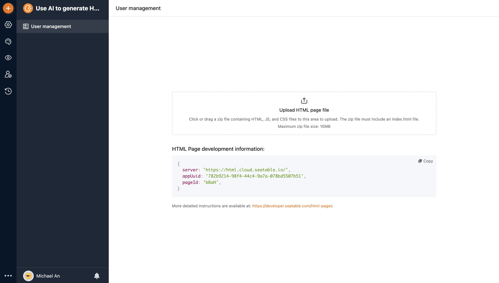

### Configure permissions

Configure page access permissions according to the page's intended use, as shown below.

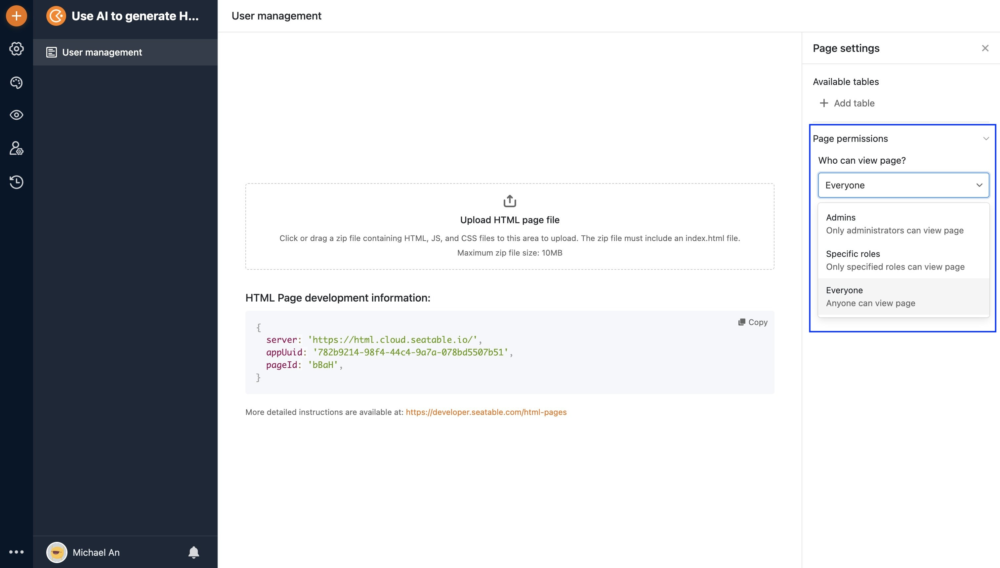

Configure table permissions as shown below.

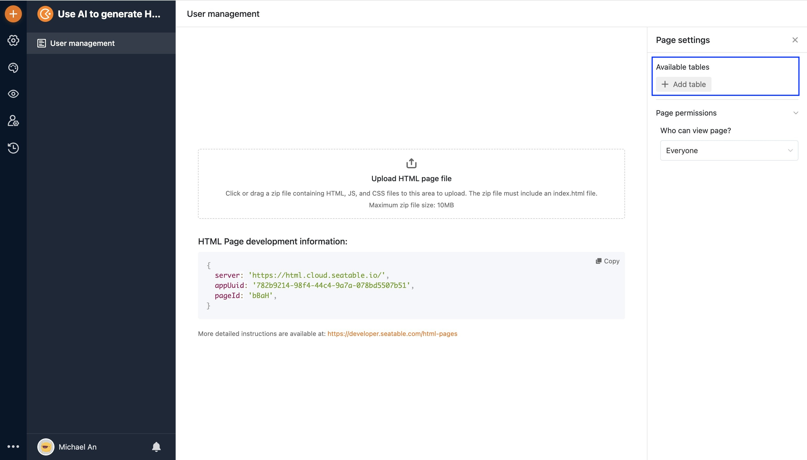

**Table 1: Products**

The page needs to list product records so users can choose what to order. Enable the "Can view records" permission for this table.

!!! warning "Review field permissions"

    Allow the page to read `Product_name` and `Unit_price` so it can display the product choices and prices. Adjust field permissions to suit your needs, especially before using the page in production.

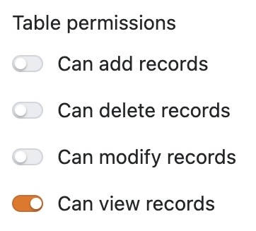

**Table 2: OrderItems**

The page needs to add order item records with the selected product and quantity. Enable the "Can add records" and "Can modify records" permission for this table. The Product field links each item to **Products**.

!!! warning "Review field permissions"

    Allow the page to add values to the Product and Quantity fields. Adjust field permissions to suit your needs, especially before using the page in production.

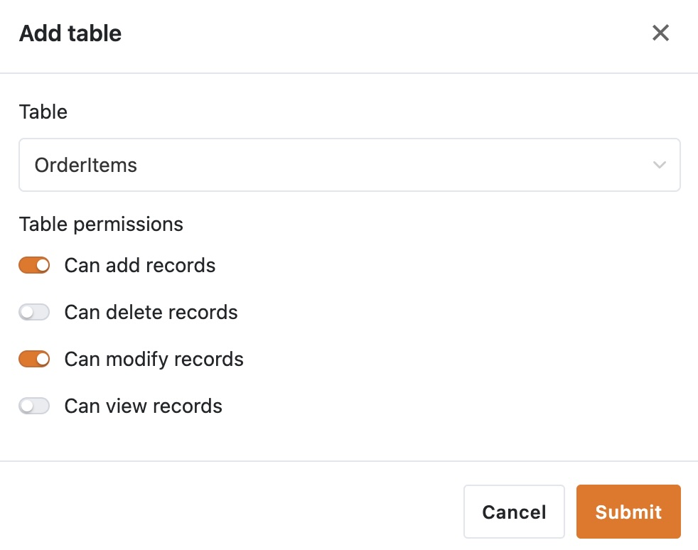

**Table 3: Orders**

The page needs to add order records to this table and link them to the order items created during submission. Enable the "Can add records" and "Can modify records" permission for this table.

!!! warning "Review field permissions"

    Allow the page to add values to the `OrderItems` field, which links to **OrderItems**. Adjust field permissions to suit your needs, especially before using the page in production.

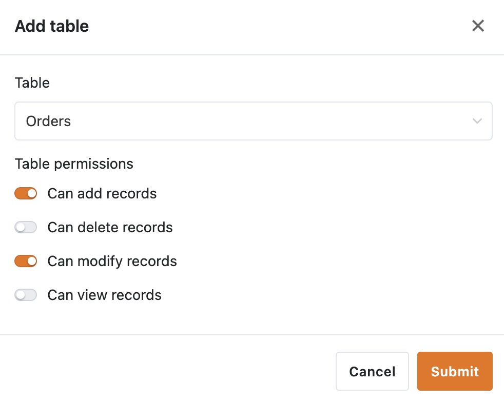

### Install the skill

If you have not used the skill before, install it first. This guide assumes that the ChatGPT Codex is already installed on your computer.

You can install the skill in either of the following ways.

**Method 1**: Send an installation command

In a conversation with the ChatGPT Codex, send the following command:

```plaintext
npx skills add seatable/skills@seatable-html-page
```

!!! note "GitHub connection required"

    If the ChatGPT Codex cannot connect to GitHub, this method may fail.

    Resolve the connection issue and try again, or use Method 2.

**Method 2 (recommended)**: Copy the skill to your local AI tool's skills directory

The skill is available in the [seatable/skills repository](https://github.com/seatable/skills). Download the repository using your preferred method, then copy `seatable-html-page` from its `skills` directory to the directory where your AI tool stores skills.

The following screenshots show where the `seatable-html-page` skill is installed on a local computer.

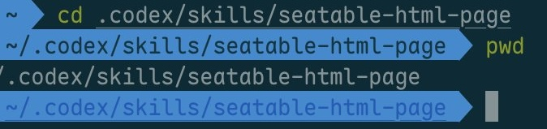

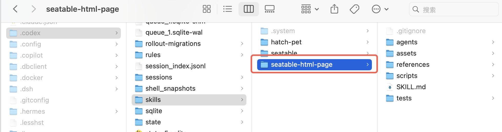

In ChatGPT, open **Plugins -> Skills** and check that "SeaTable HTML Page" appears in the list.

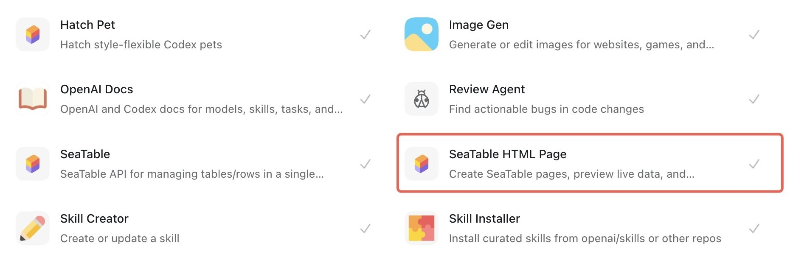

You can also enter `/seatable` in a conversation. If "SeaTable HTML Page" appears in the list of available skills, the skill is installed.

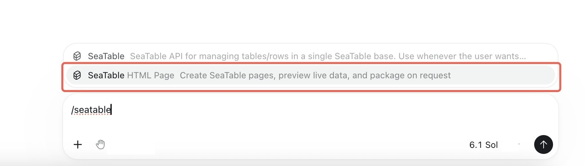

### Create a ChatGPT project

To keep your work organized, create a ChatGPT project for each HTML page. You will create a local folder for the page and link it to the project in the following steps.

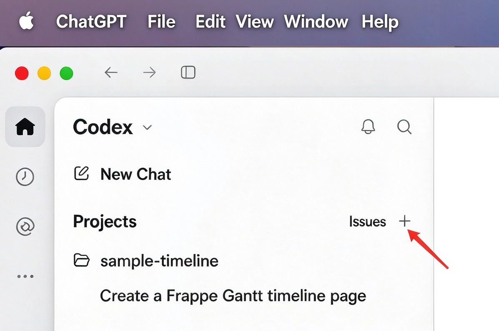

Create a folder for the page in a convenient location, using any method you prefer.

The project name is optional. If you leave it blank, ChatGPT uses the folder name by default.

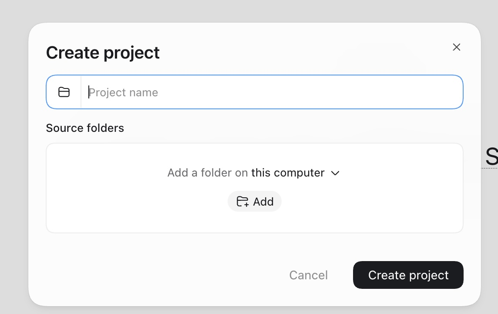

Once the project has been created, a new conversation for it starts automatically.

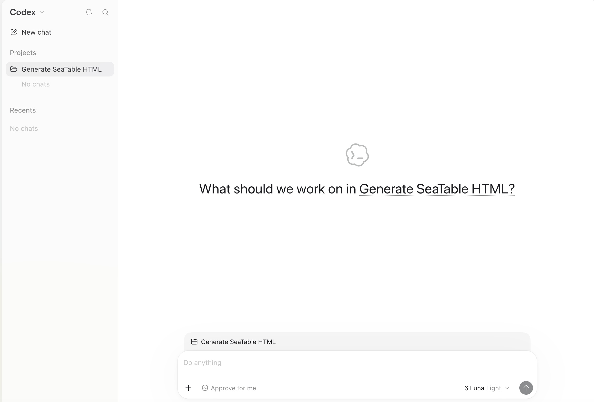


## Generate a page with ChatGPT Codex

### Select the skill and configure the local development environment

Enter `/seatable` and select the page-generation skill from the pop-up list.

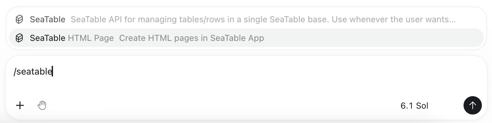

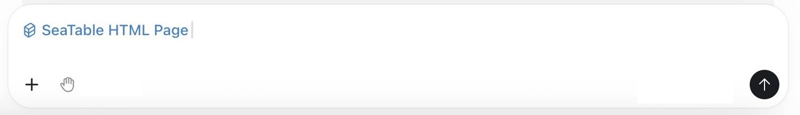


After selecting the skill, ask it to set up the local development environment.

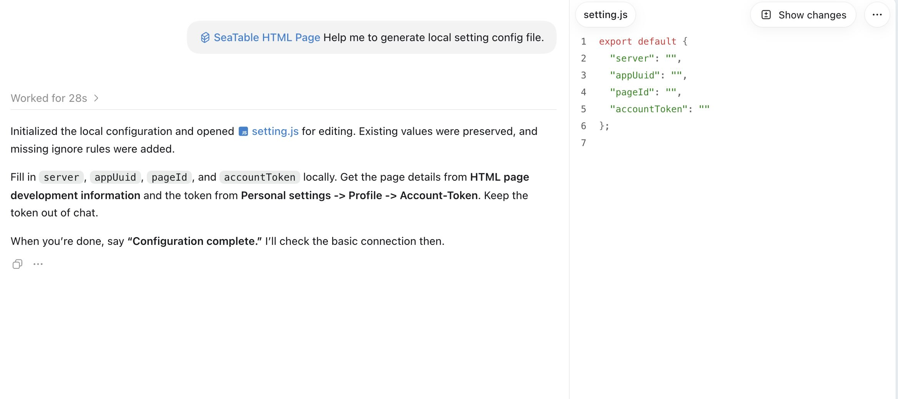


In the configuration file, enter the server address, `appUuid`, and `pageId` shown for the blank HTML page you created during setup.

!!! warning "Keep your account token private"

    Find your `accountToken` under **Personal Settings -> Personal Information -> Account Token**. Do not share it in the conversation, because it could give others access to your account.

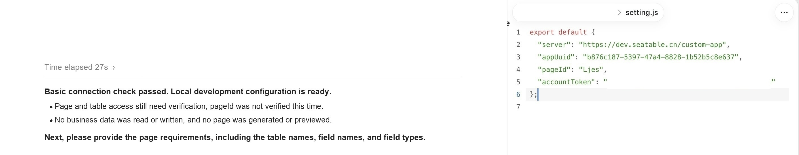


### Describe the page and data structure

Describe the page you want to generate, including its functionality, workflow, and visual style. Providing detailed requirements can reduce the amount of revision needed later. For example:

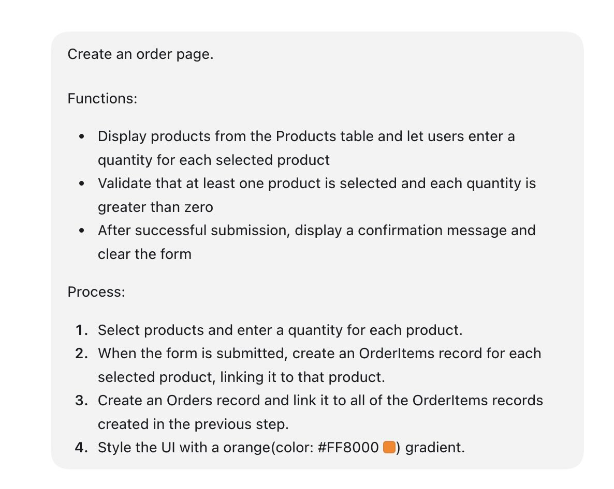

!!! example "Example prompt"

    ```plaintext
    Create an order page.

    Functions:
    - Display products from the Products table and let users enter a quantity for each selected product
    - Validate that at least one product is selected and each quantity is greater than zero
    - After successful submission, display a confirmation message and clear the form

    Process:
    1. Select products and enter a quantity for each product.
    2. When the form is submitted, create an OrderItems record for each selected product, linking it to that product.
    3. Create an Orders record and link it to all of the OrderItems records created in the previous step.
    4. Style the "Submit" button with a orange(color: #FF8000) gradient.
    ```

The skill may ask for details about the tables, fields, and other data structures the page needs. If you have not already provided this information, the AI will prompt you for it.

You can also include these details in your initial request. If the AI detects that you have already specified the data structure, it will proceed directly to generating the page.

**Example of additional data structure details:**

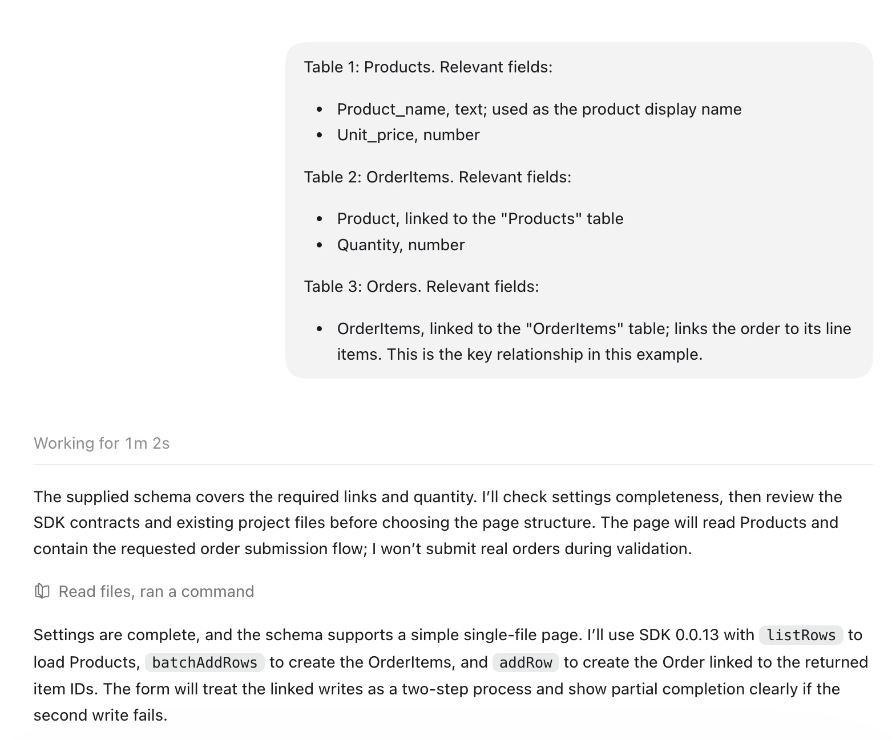

!!! example "Example data structure"

    ```plaintext
    Table 1: Products. Relevant fields:
    - Product_name, text; used as the product display name
    - Unit_price, number

    Table 2: OrderItems. Relevant fields:
    - Product, linked to the "Products" table
    - Quantity, number

    Table 3: Orders. Relevant fields:
    - OrderItems, linked to the "OrderItems" table; links the order to its line items. This is the key relationship in this example.
    ```


### Generate the HTML page

After you provide the requirements and data structure, the AI begins generating the page.

If a confirmation prompt like the one below appears, select "Allow once."

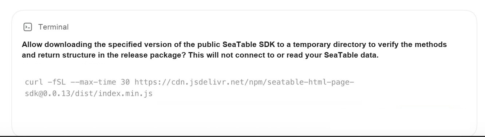

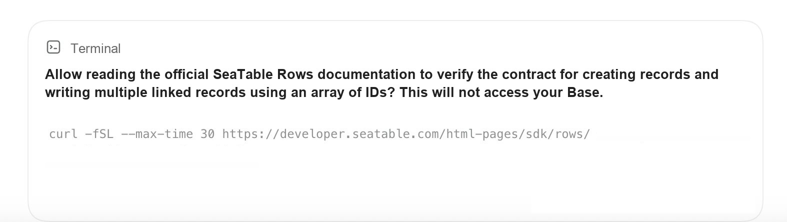

The AI then completes the generation process.

When generation is complete, the AI displays a summary similar to the following:

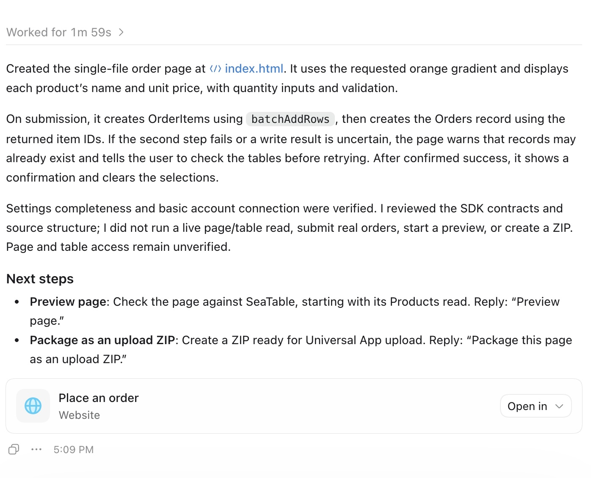

Choose **Preview Page** to preview the result.

The generated page files are saved in the corresponding local project folder:

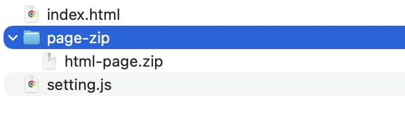

## Preview page

When the preview service starts, the page opens automatically in ChatGPT. You can also open the service address in your preferred browser. By default, the address is [http://127.0.0.1:3005](http://127.0.0.1:3005/).

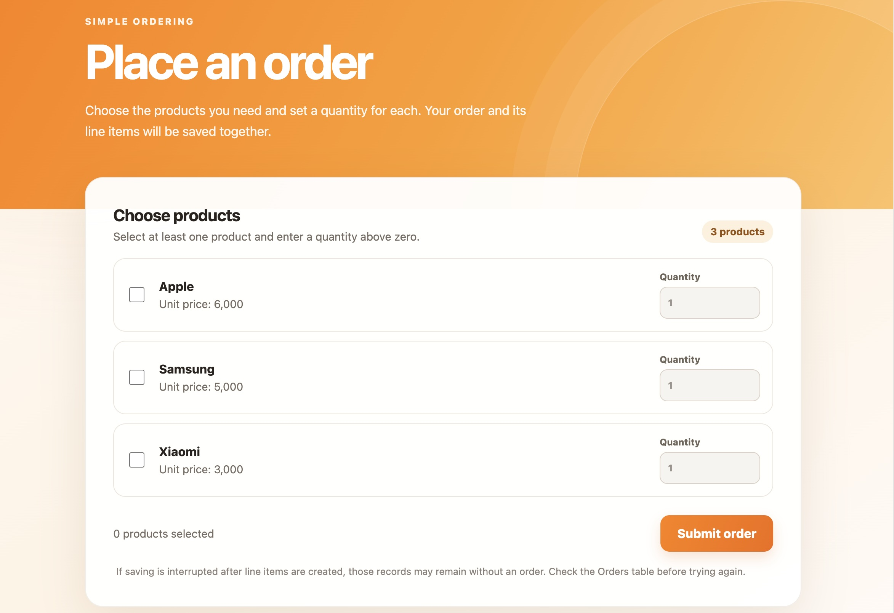

When you finish testing, send the **Cancel Preview** command to stop the preview service.

## Package and upload the page

After testing the page and confirming that it works as expected, send the instruction "Package as an upload ZIP". The AI will then run the packaging script.

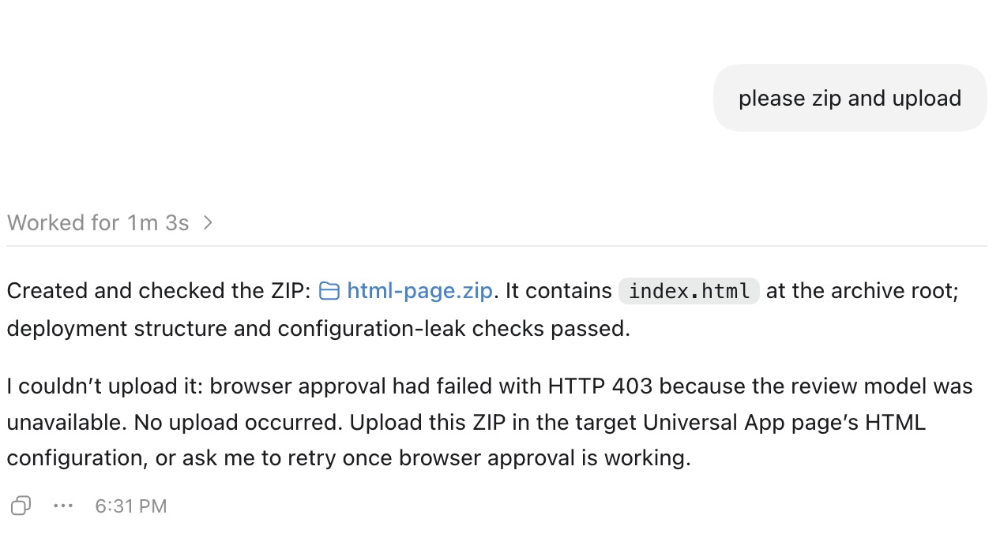

Upload the ZIP file to the HTML page in the app.

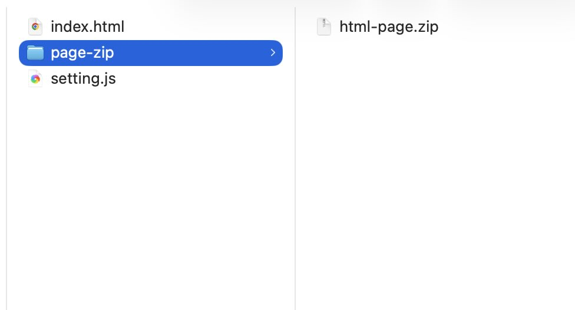

The uploaded page appears in the app as follows:

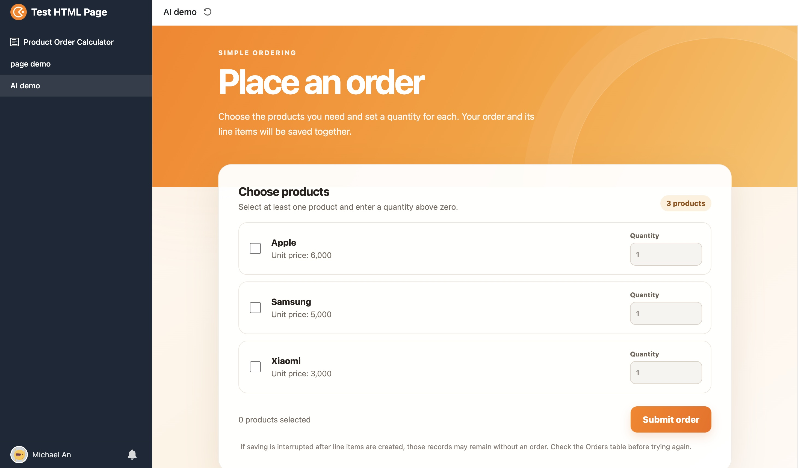
