# Build an HTML Page with ChatGPT codex

This document demonstrates how to use the SeaTable HTML Page skill in the ChatGPT client to generate an HTML page for an app. It walks through the process of creating a form as an example.

The example form is designed for a customer management scenario involving two linked tables: a customer registration table and a sales personnel table.

When creating a customer record, users must provide basic customer information and link one or more sales personnel records.

## 1. Preliminary Preparations

### 1.1 Associated App and HTML Page

Base containing the app:

Create an app and an HTML Page in the associated Base.

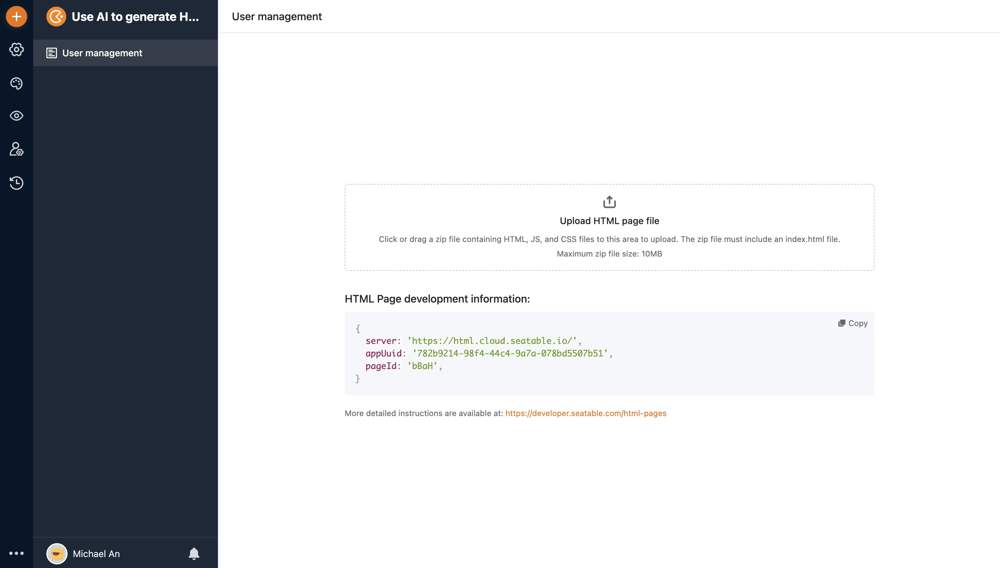

### 1.2 HTML Page Permission Configuration

#### 1.2.1 Page Permissions

As shown in the screenshot, configure page access permissions according to the page's intended use.

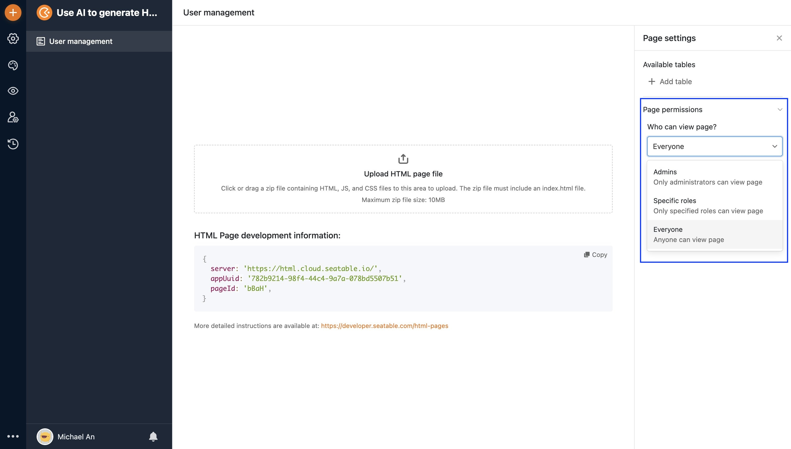

#### 1.2.2 Table-Related Permissions

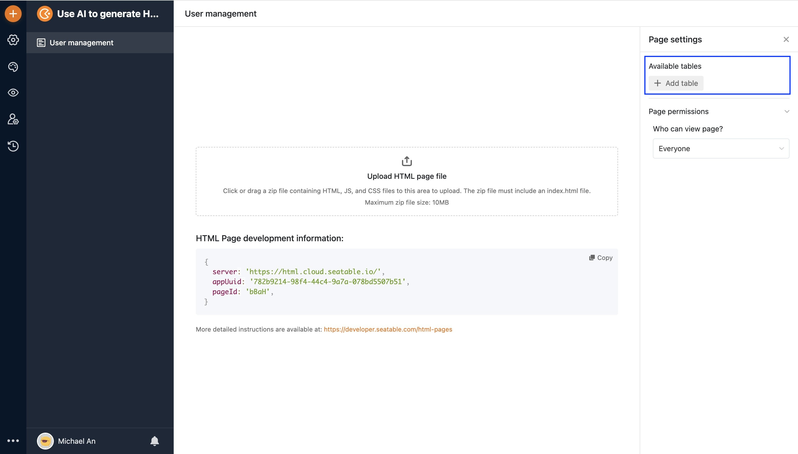

**Table 1: Customer Registration**

Records must be added to this table and linked records must be updated, so enable the "Can add records" and "Can modify records" permissions for this table.

!!! warning "Review field permissions"

    For convenience during testing, permissions to add values to all fields are enabled. Adjust these permissions to suit your needs, especially before using the page in production.

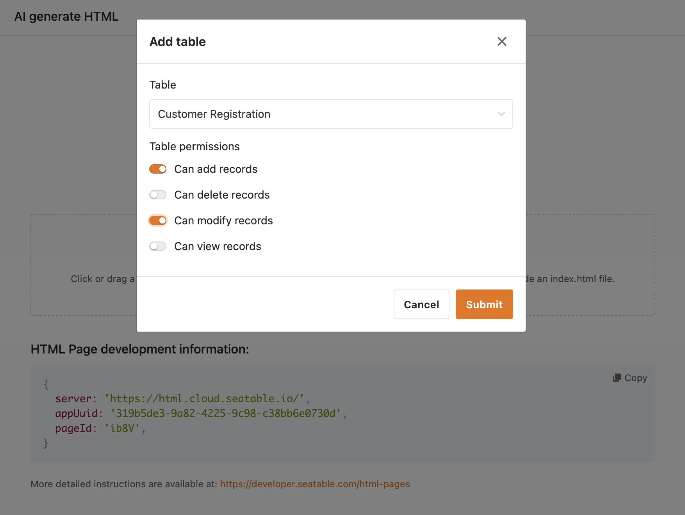

**Table 2: Sales Personnel**

When adding a customer record, it must be linked to a record in this table. To do so, the page needs to be able to list records in this table, so enable the table's "Can list records" permission.

!!! warning "Review field permissions"

    For testing purposes, permissions for all fields are also enabled here. Adjust them to suit your needs, especially before using the page in production.

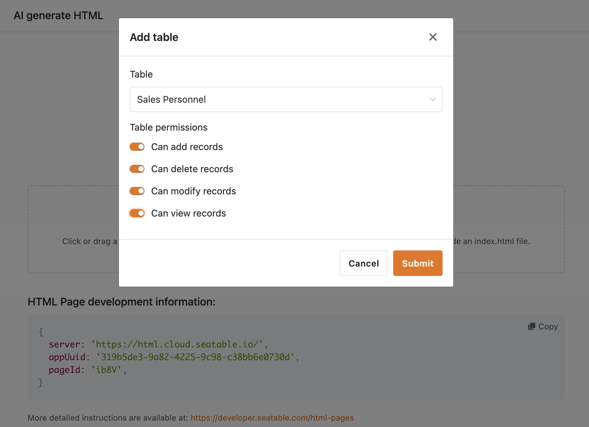


### 1.3 Install the Skill

If this is your first time using the skill, install it first. This assumes that you have already installed the ChatGPT client on your local machine.

#### 1.3.1 Installation

You can install the skill in either of the following ways.

**Method 1**: Send an Installation Command

In a conversation with the ChatGPT client, send the following command:

```plaintext
npx skills add seatable/skills@seatable-html-page
```

!!! note "GitHub connection required"

    This method may fail if the ChatGPT client cannot connect to GitHub. Resolve the connection issue and try again, or use Method 2 instead.

**Method 2 (Recommended)**: Copy the Skill to Your Local AI Tool's Skills Directory

The skill is available in the [seatable/skills repository](https://github.com/seatable/skills). Download the repository to your computer using whichever method you prefer. Then copy the `seatable-html-page` skill from the repository's `skills` directory to the directory where your local AI tool stores its skills.

The following screenshots show the directory where the `seatable-html-page` skill is installed on my computer.

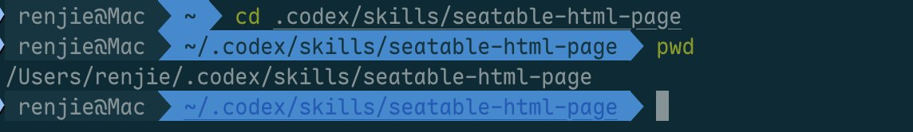

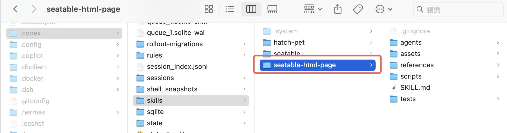

#### 1.3.2 Verification

Open **ChatGPT -> Plugins -> Skills** and check that "SeaTable HTML Page" appears in the list of skills.

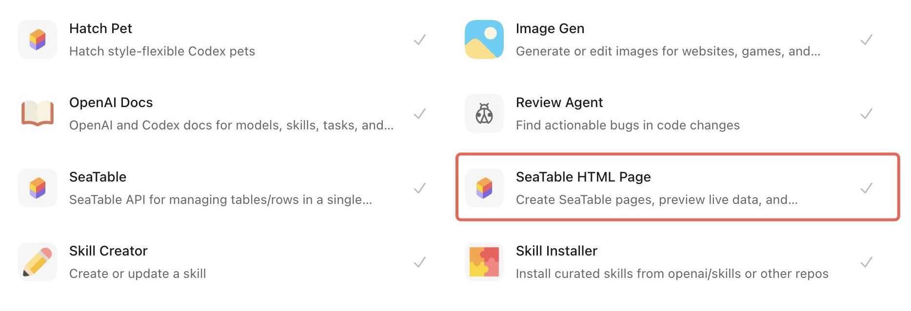

You can also enter `/seatable` in a conversation. If "SeaTable HTML Page" appears in the list of available skills, the installation was successful.

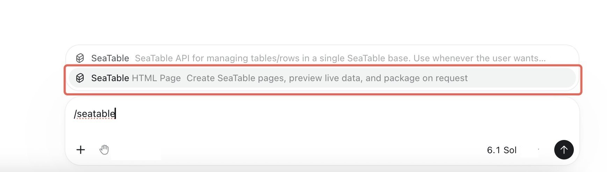

## 2. Create a Project

To better manage the generated pages, create a ChatGPT project for each HTML page. Associate each project with the local folder that contains the page.

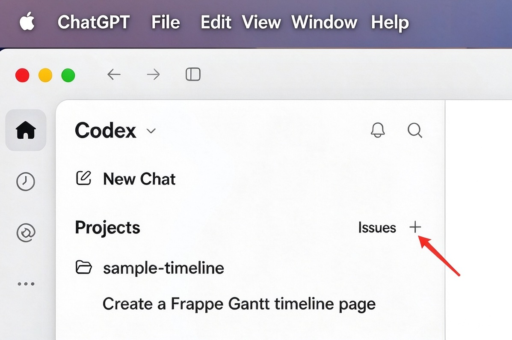


### 2.1 Create a Project Folder on Your Local Machine

As shown in the screenshot, use whichever method you prefer to create the folder in a suitable location.

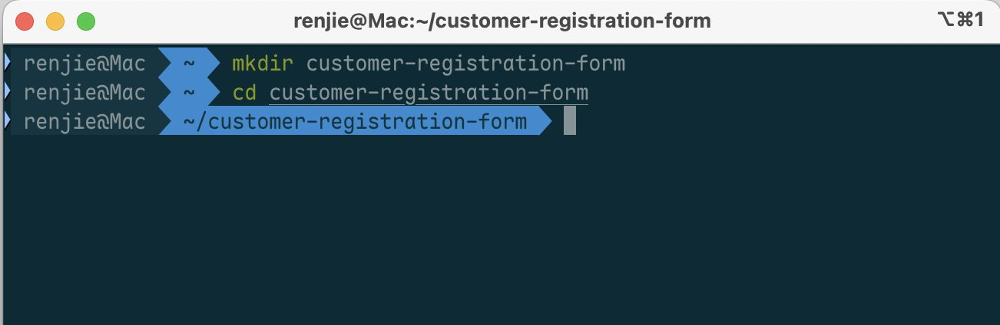

### 2.2 Link the Folder to a ChatGPT Project

The project name is optional. If you do not specify one, the folder name is used by default.

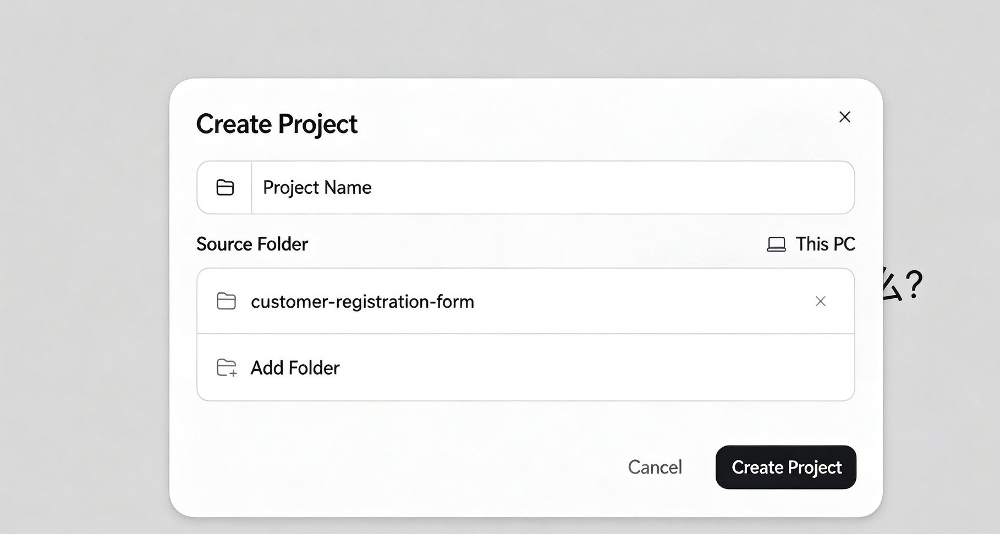

Once the project has been created, a new conversation for it starts automatically.

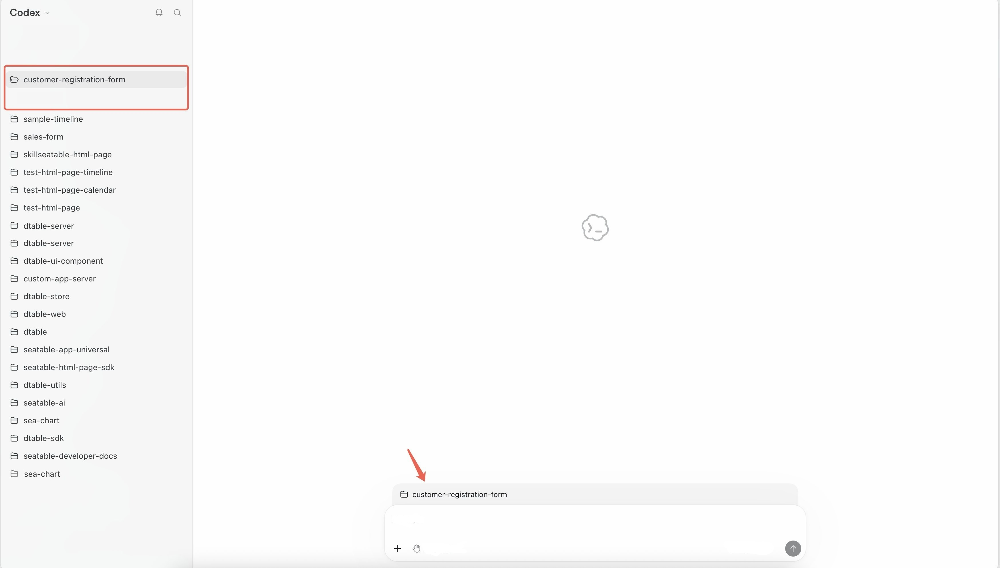


## 3. Generate a Page with the Skill

### 3.1 Select a Skill

Enter `/seatable` and select the page-generation skill from the pop-up list.

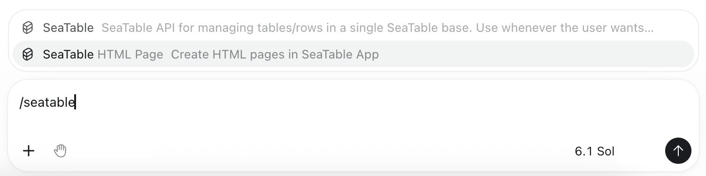

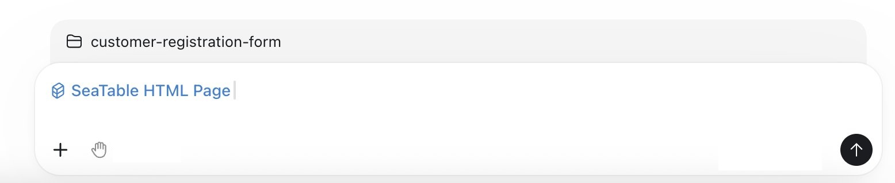


### 3.2 Configure the Local Development Environment

#### 3.2.1 Start Configuration

After selecting the skill, ask it to configure the local development environment. For example, you can request help with the development setup.

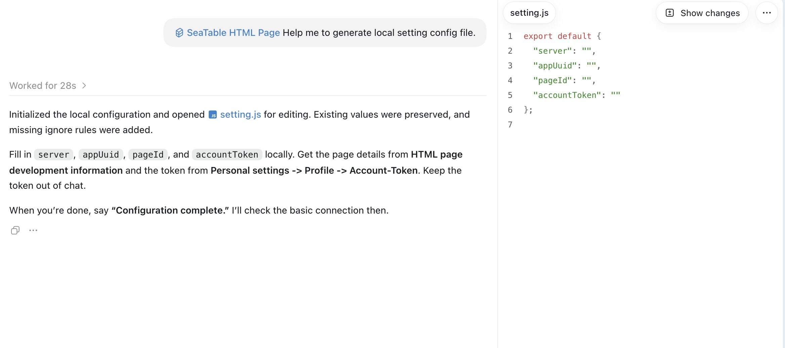


In the configuration file, enter the server, `appUuid`, and `pageId` shown for the blank HTML Page you created in the "Preliminary Preparations" section.

!!! warning "Keep your account token private"

    Find your `accountToken` under **Personal Settings -> Personal Information -> Account Token**. Do not share it in the conversation, as doing so could expose your account.

#### 3.2.2 Configuration Complete and Verified by AI

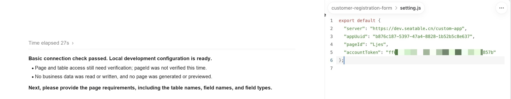


### 3.3 Describe the Page to Generate

In this step, describe the page you want to generate, including its functions, features, workflow, and style. The more detail you provide, the less time you will need to spend revising it later. See the example below:

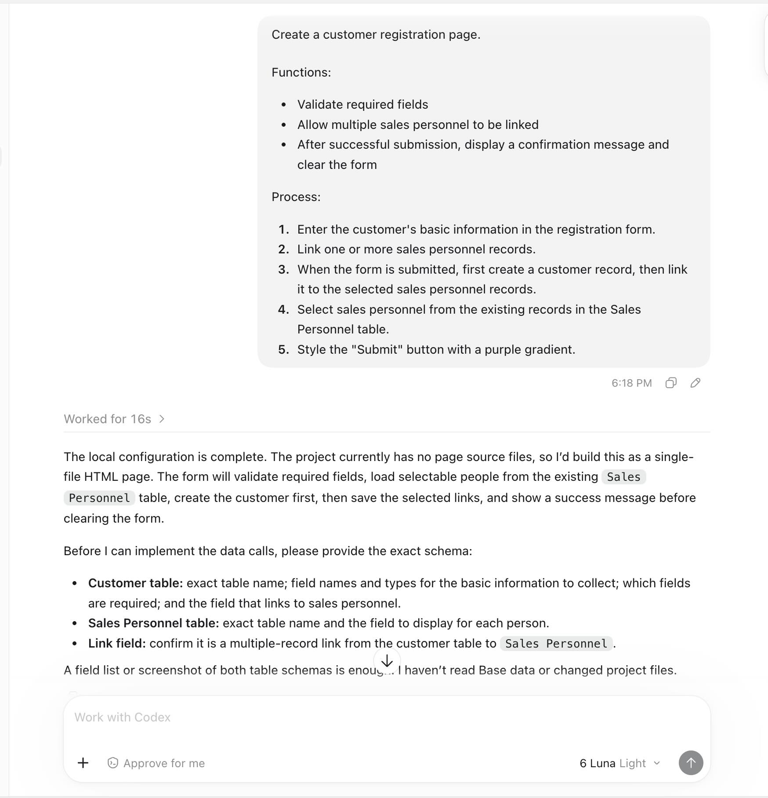

!!! example "Example prompt"

    ```plaintext
    Create a customer registration page.

    Functions:
    - Validate required fields
    - Allow multiple sales personnel to be linked
    - After successful submission, display a confirmation message and clear the form

    Process:
    1. Enter the customer's basic information in the registration form.
    2. Link one or more sales personnel records.
    3. When the form is submitted, first create a customer record, then link it to the selected sales personnel records.
    4. Select sales personnel from the existing records in the Sales Personnel table.
    5. Style the "Submit" button with a purple gradient.
    ```

### 3.4 Provide Additional Information

The page-generation skill will ask you to describe the tables, fields, and other structures needed for the page. If you have not included these details in your earlier instructions, the AI will prompt you to provide them.

You can also provide all of this information in the previous step. If the AI detects that you have already specified the data structure, it will proceed directly to page generation.

**Providing additional data structure details:**

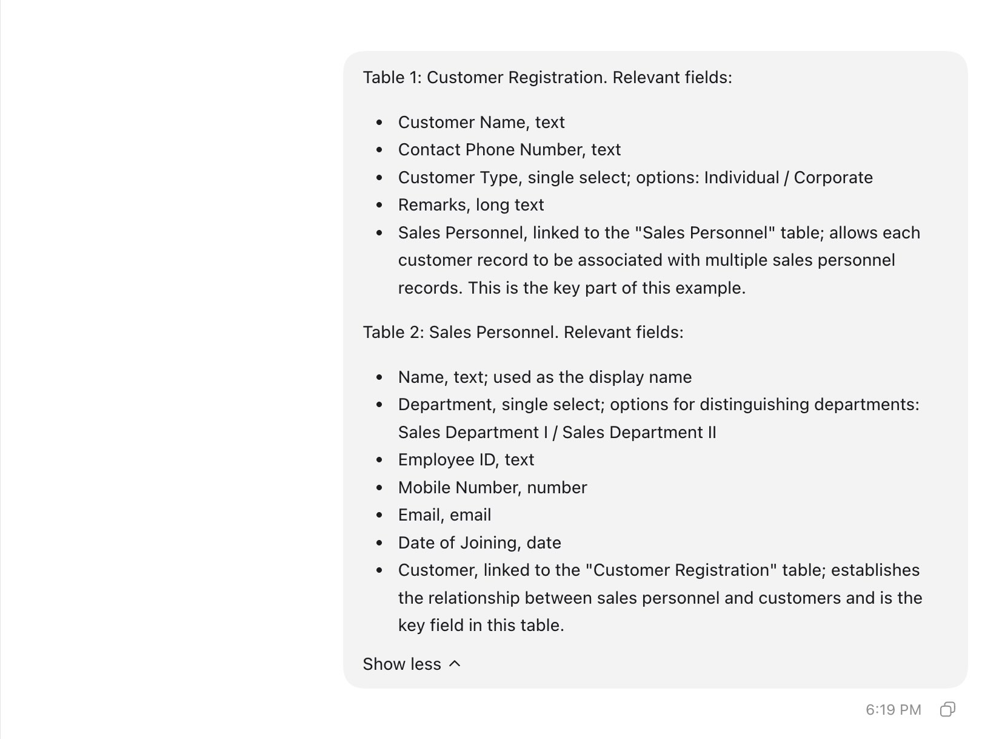

!!! example "Example data structure"

    ```plaintext
    Table 1: Customer Registration. Relevant fields:
    - Customer Name, text
    - Contact Phone Number, text
    - Customer Type, single select; options: Individual / Corporate
    - Remarks, long text
    - Sales Personnel, linked to the "Sales Personnel" table; allows each customer record to be associated with multiple sales personnel records. This is the key part of this example.

    Table 2: Sales Personnel. Relevant fields:
    - Name, text; used as the display name
    - Department, single select; options for distinguishing departments: Sales Department I / Sales Department II
    - Employee ID, text
    - Mobile Number, number
    - Email, email
    - Date of Joining, date
    - Customer, linked to the "Customer Registration" table; establishes the relationship between sales personnel and customers and is the key field in this table.
    ```


### 3.5 Generate the Page

After you describe the requirements and data structure, the AI begins generating the page.

If a confirmation prompt like the one below appears, click "Allow once."

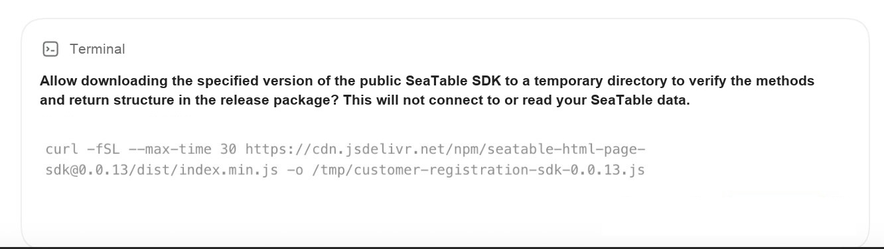

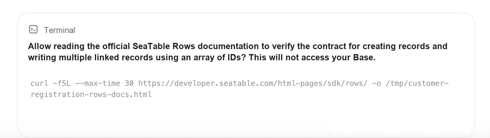

The AI will handle the rest of the generation process.

Once generation is complete, the AI will display a message similar to the following:

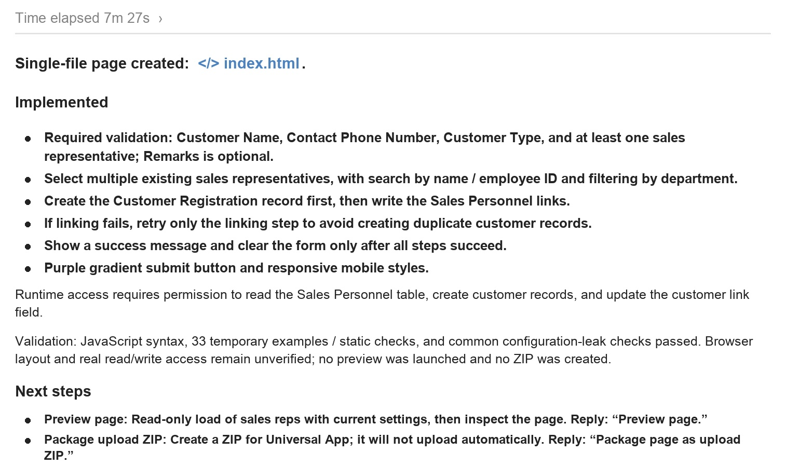

Generated Page:

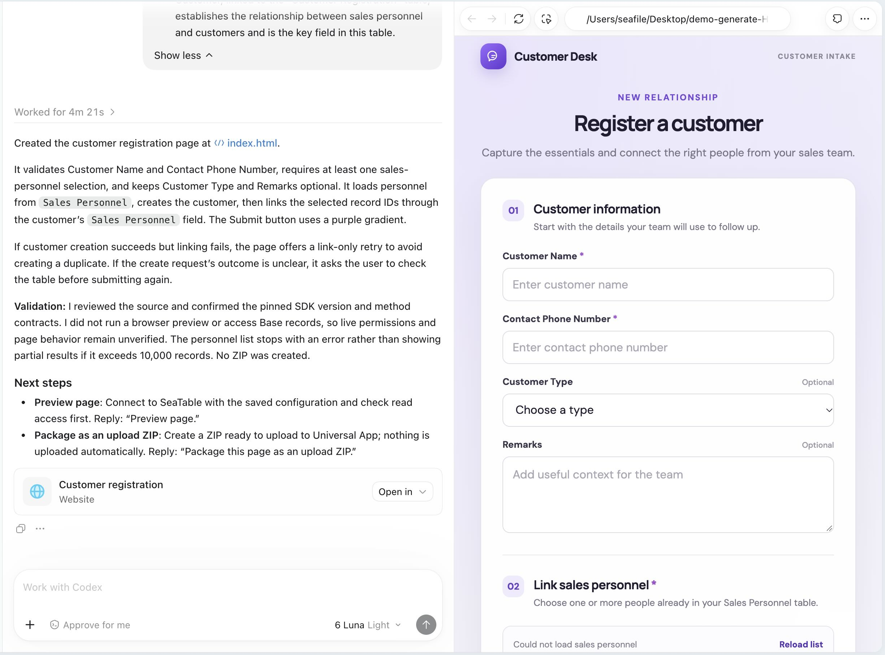

You can also find the generated files in the corresponding folder on your local machine:

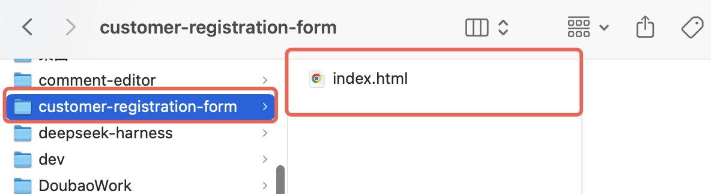


Next, choose **Preview Page** to preview the page or **Package as an upload ZIP** to create a ZIP file for uploading to the associated HTML Page.

### 3.6 Modify the Page (Optional)

If the generated page does not meet your requirements, you can ask the AI to make further changes. For example, some field definitions in the instructions above are incorrect, so we will correct them here.

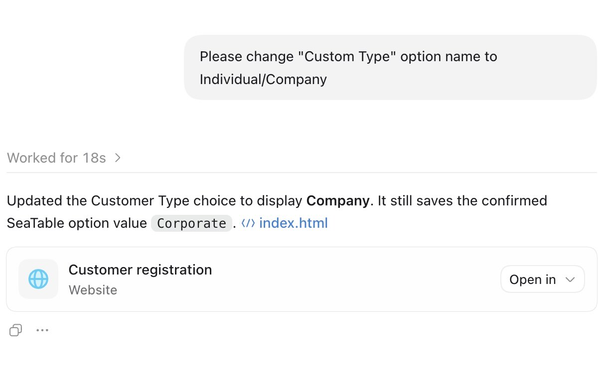


## 4. Preview the Page

Once the preview service starts, the preview opens automatically in ChatGPT. You can also open the service address in your usual local browser (default: [http://127.0.0.1:3005](http://127.0.0.1:3005/)):

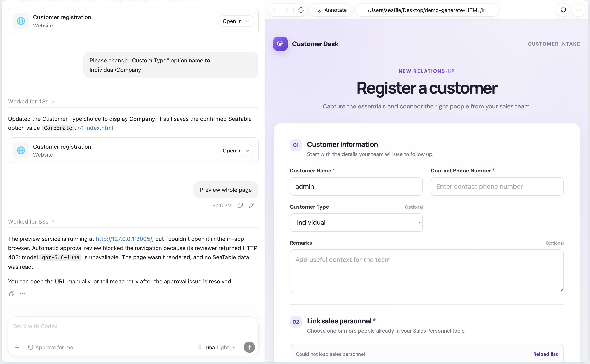

When you are finished previewing the page, send the **Cancel Preview** command to stop the preview service.

**Test features such as input validation and form submission:**

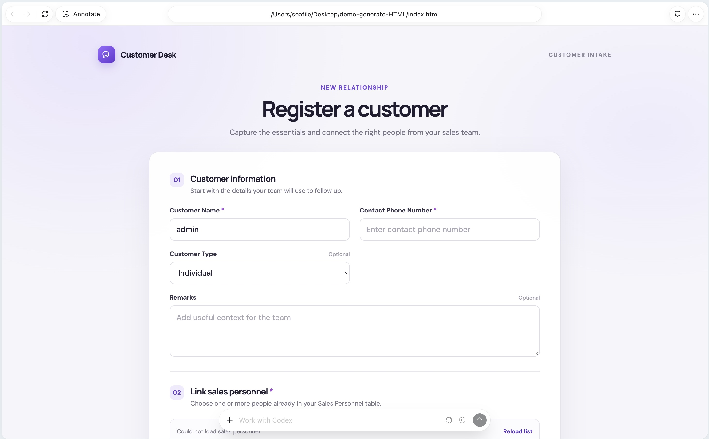

**Check the data submitted to the Base:**

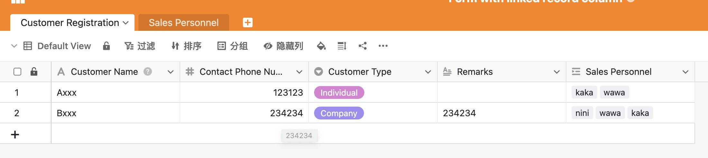


## 5. Package and Upload the Page

Once you have tested the generated page in the preview and confirmed that it works properly, send the instruction "Package as an upload ZIP" and wait for the AI to run the packaging script.

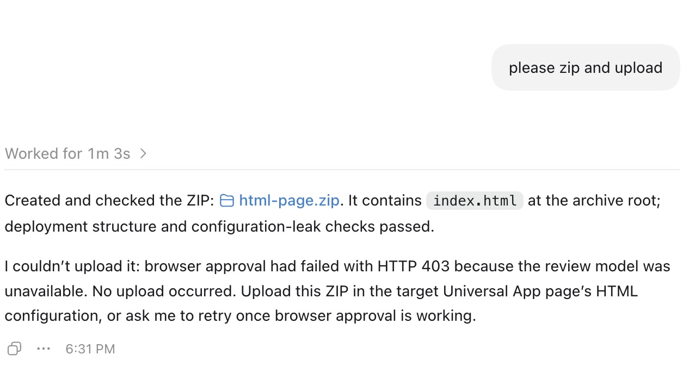

Upload the ZIP file to the associated HTML Page in the app.

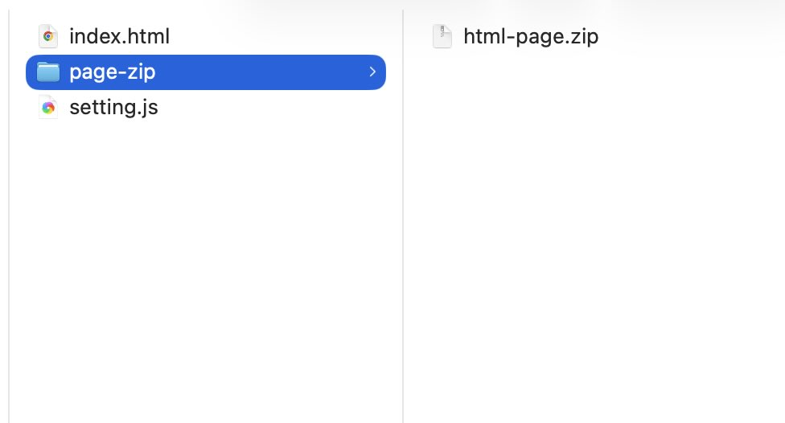

Result after uploading the page to the app:

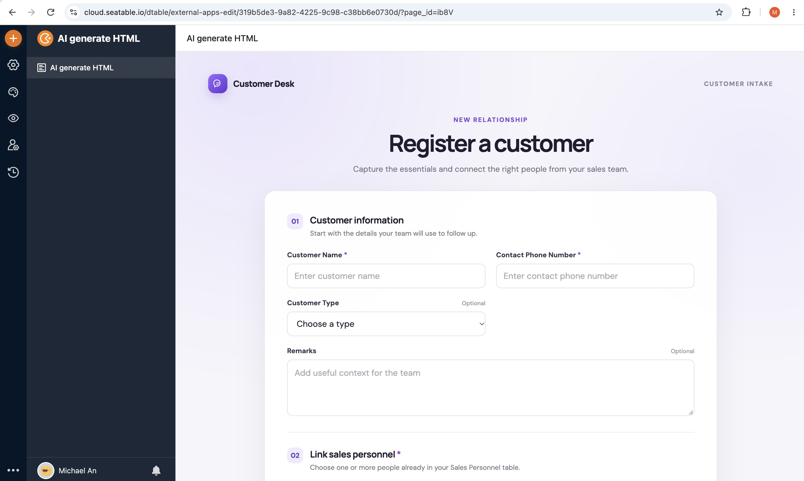
