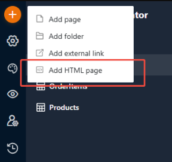
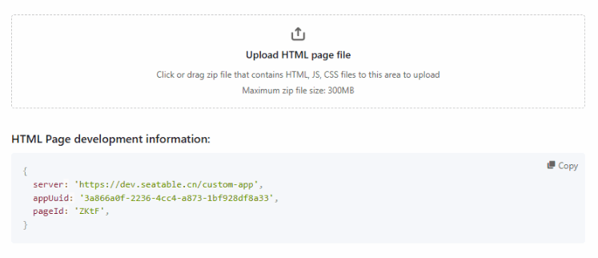
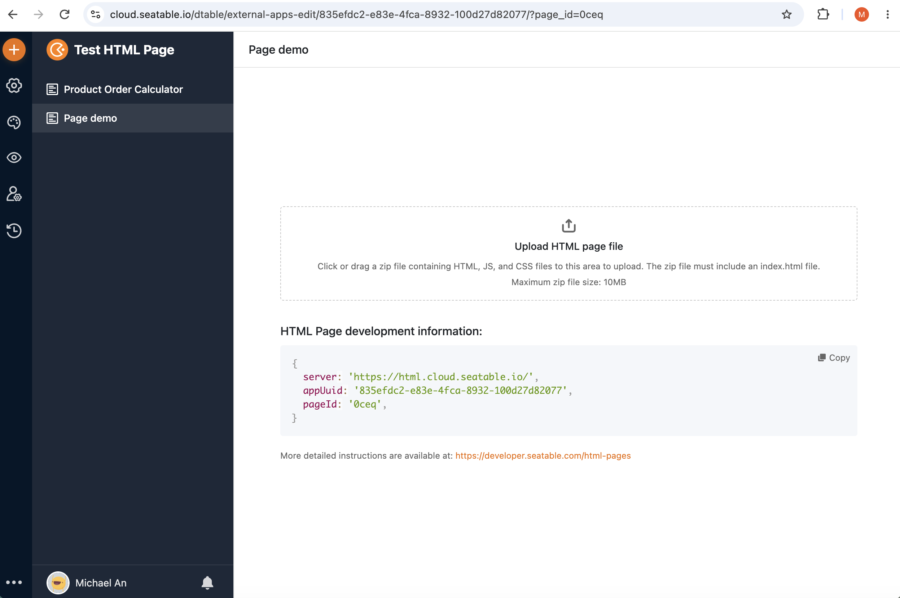
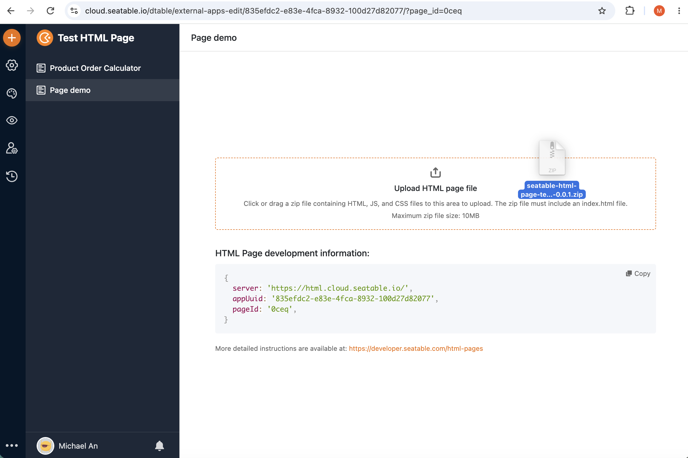
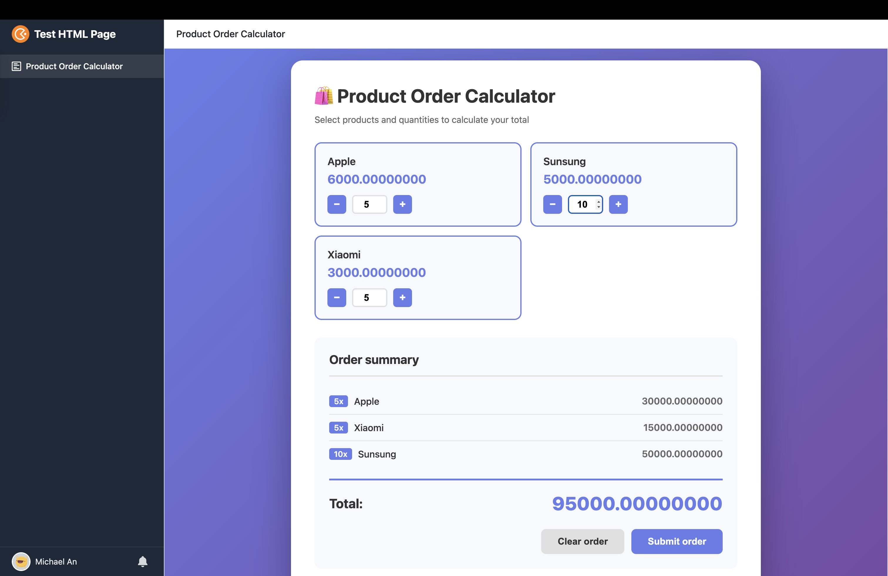
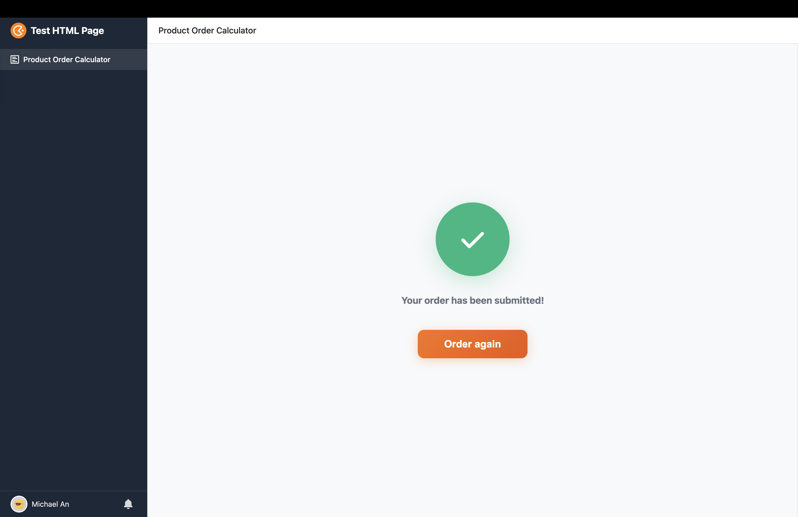
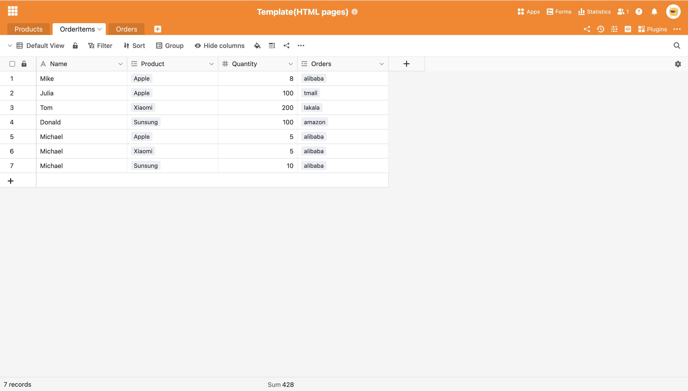

# Developer setup

This is the **developer setup**: you clone the official template and use a full JavaScript toolchain (Node.js, npm, a Vite dev server with live reload, and a build step). It suits larger or more complex pages.

!!! tip "Prefer no toolchain?"

    If you just want a form or a small tool, you can build a page in a visual editor with no Node.js or npm at all — see the [Low-code quickstart](low-code-quickstart.md). You can always move up to this setup later.

This guide walks through building an HTML page from the official [simple form template](https://github.com/seatable/seatable-html-page-template-simple-form): a form that writes submitted records into a base. By the end you will have a packaged ZIP that you can upload to a Universal App.

The template ships the build configuration and project structure you need. It supports two development styles:

- **Modular** — HTML, JavaScript and CSS split across multiple files. Suited for complex pages.
- **Non-modular** — everything in a single `index.html`. Suited for simple pages.

Choose the approach that fits the complexity of your page. Both produce the same kind of uploadable package.

!!! note "Base requirements for this example"

    The form reads products from the base and writes orders back, so it expects three tables:

    - **Products** — with `ProductName` (text) and `UnitPrice` (number)
    - **OrderItems** — with `Product` (link to Products) and `Quantity` (number)
    - **Orders** — with `OrderItems` (link to OrderItems)

    Create them in your base before running the page, or adapt the table and field names in the template's source.

    You can use the [example base](https://cloud.seatable.io/dtable/external-links/c3593e011ef841238d99/) to test the page.

## Before you start: add an HTML page in the app

In your Universal App, add a new page and choose **Add HTML page**. This creates the empty page you will later upload your build to, and it surfaces the `server`, `appUuid` and `pageId` values you need for local development ([step 3](#3-configure-local-development)).



## 1. Get the template

```shell
git clone https://github.com/seatable/seatable-html-page-template-simple-form.git
cd seatable-html-page-template-simple-form
npm install
```

## 2. Choose a development style

The active style is controlled by the `ESM` variable in `.env`. Vite derives its `root` from it automatically (`src/esm` when `true`, `src/classic` when `false`) — you do not edit `vite.config.js`.

=== "Modular"

    JavaScript and CSS are split into multiple files under `src/esm`, and the entry file is imported into `index.html` with `type="module"`. The SDK is used via the npm package (`import { HTMLPageSDK } from "seatable-html-page-sdk"`).

    Enable it by setting `ESM=true`. Either edit `.env` directly, or copy `.env` to `.env.local` (git-ignored) and set it there.

=== "Non-modular"

    All logic lives in a single `index.html` under `src/classic`, with the SDK loaded from a CDN. This is the template default (`ESM=false`), so no extra configuration is required.

## 3. Configure local development

During local development, the page needs to know which base to talk to. Create `src/setting.js` based on `setting.template.js`:

```js
export default {
  server: "",
  appUuid: "",
  pageId: "",
  accountToken: "",
};
```

These values are registered to `window.__HTML_PAGE_DEV_CONFIG__` and picked up by the SDK when you call `init()` in development. See [Initialization](sdk/initialization.md) for how the SDK consumes them.

!!! note "Where the values come from"

    - `accountToken` — your account token, available under **Personal settings -> Profile -> Account-Token**. This is not a base API token.
    - `server`, `appUuid` and `pageId` — shown under **HTML page development information** in the page's configuration (see below).

!!! note "Why use accountToken instead of baseAPIToken?"

    Some HTML page features require user information that a base API token cannot provide. Local development therefore uses an account token for:

    - Checking HTML page access permissions.
    - Calling APIs that retrieve the current user's information.

    If view support is added in the future, some view filters may also require user information.

The HTML page configuration shows these values ready to copy, alongside the upload area you will use later:



## 4. Run the development server

```shell
npm run dev
```

Open the local development URL in your browser to preview and test the page. Changes reload live.

## 5. Build and package

Generate the uploadable ZIP:

```shell
npm run build-page
```

This single command cleans the output, runs the Vite build (into `dist`), and packages it into a ZIP under the `page-zip` directory. The ZIP is named after the project, for example `seatable-html-page-template-simple-form-0.0.1.zip` — bump the `version` in `package.json` before building so you can tell uploads apart.

!!! note "Inspecting the build"

    `npm run build-page` already runs the build, so you do not call `npm run build` separately. Run `npm run build` on its own only if you want to inspect the unpackaged output in `dist`, or `npm run dev` to preview it live.

## 6. Upload and test

Step 1: In SeaTable, open the configuration of the HTML page in your Universal App.



Step 2: Drag the generated ZIP into the **Upload HTML page file** area (the same configuration shown in [step 3](#3-configure-local-development)).



Step 3: Open the app preview, fill in the form.



Step 4: Submit the order.



Step 5: Return to the base and confirm that the corresponding records were created.



Once the submitted records appear in the base, the page is fully integrated and ready to use.

## Next steps

- [SDK Reference: Initialization](sdk/initialization.md)
- [SDK Reference: Rows](sdk/rows.md)
- [SDK Reference: Files & Images](sdk/files.md)
